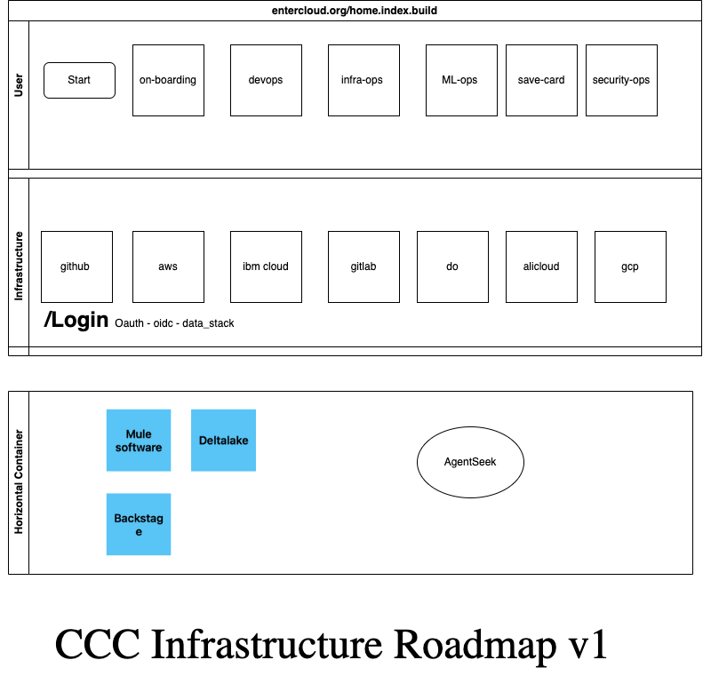

# [Cloud Command Center](http://entercloud.org) - [project pages](http://github.com/entercloud)

[Cloud command center](http://entercloud.org) is a multipurpose tool kit for [Entercloud platform](http://entercloud.org/) created by [entercloud](http://entercloud.org).

## Getting Started

To begin using this template, choose one of the following options to get started:
* [Download the latest release on entercloud.org/builds](http://entercloud.org)
* Clone the repo: `git clone https://github.com/entercloud/cloud-command-center.git`
* Fork the repo


## Roadmap v1 


* Unified Access Control:
 OAuth/OIDC secures all business unit applications through a single gateway.
* GitOps Automation:
 Infrastructure and landing pages are versioned, tested, and deployed via Git repositories (GitHub/GitLab → Cloud platforms).
* Multi-Cloud Flexibility:
Agnostic to cloud providers (AWS, GCP, IBM, etc.), ensuring vendor resilience.
* Developer Self-Service:
Backstage.io allows teams to manage landing pages without central bottlenecks.

## Bugs and Issues

Have a bug or an issue with this template? [Open a new issue](https://github.com/entercloud/cloud-command-center/issues) here on GitHub or leave a comment on the [Cloud page](http://facebook.com/entercloud).

## Creator

Cloud command center was created by and is maintained by **[Andrew S Thompson](https://www.linkedin.com/in/cloudchief/)**, Owner of [Entercloud LLC](http://entercloud.info).

* https://twitter.com/andrewpsp
* https://github.com/andrewpsp


## Copyright
```
Copyright 2025 Entercloud LLC.
```
